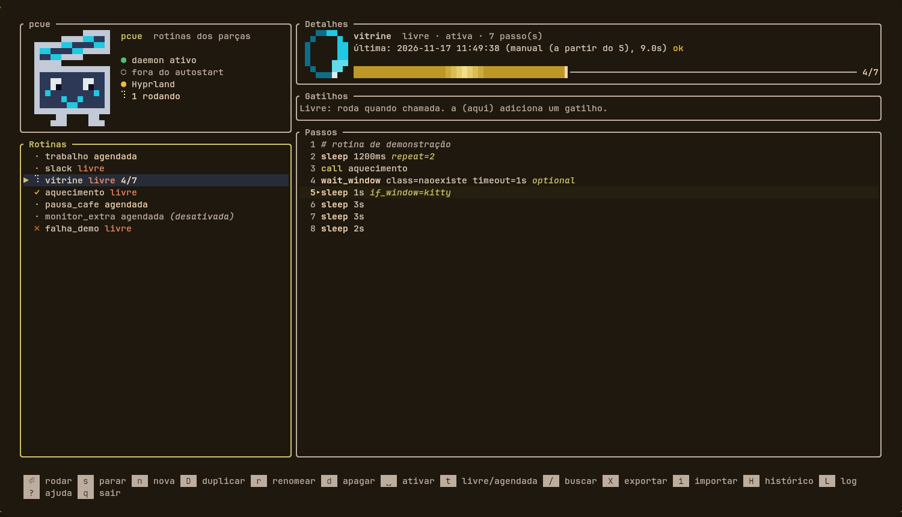
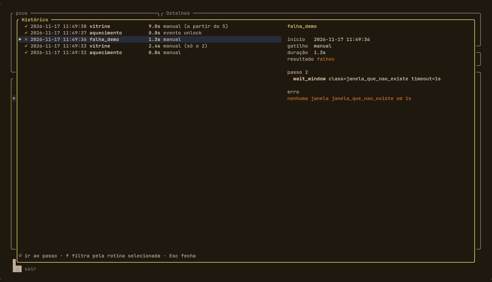

<div align="center">


# pcue

**Rotinas dos parças para o desktop Linux.**
Abre seus apps nos workspaces certos, grava o que você faz com teclado e mouse
e repete tudo no login, no desbloqueio, num horário ou quando você mandar.


</div>

---

## O que é

O pcue (de *cue*, a deixa do teatro) organiza **rotinas**: sequências de passos
como abrir um app num workspace, esperar a janela aparecer, apertar um atalho,
digitar um texto ou clicar num ponto de uma janela.

- **Rotinas livres** rodam quando você chama: `Enter` na TUI, duplo clique,
  `pcue run nome` ou um atalho do Hyprland.
- **Rotinas agendadas** rodam sozinhas pelo daemon: login, bloqueio,
  desbloqueio, volta da suspensão, monitor conectado/desconectado, eventos
  próprios, horário diário ou intervalo.

Tudo é gerenciado numa TUI animada, com mouse, mascote em pixel art e
acompanhamento ao vivo das execuções.

## Prints

<table>
<tr>
<td width="50%"><br/><sub><b>Execução ao vivo</b>: spinner, barra de progresso e passo atual destacado.</sub></td>
<td width="50%"><br/><sub><b>Histórico</b>: quando, gatilho, duração, passo que falhou e erro.</sub></td>
</tr>
<tr>
<td colspan="2"><br/><sub><b>Gravação</b>: contagem, REC pulsando e os passos aparecendo enquanto você age.</sub></td>
</tr>
</table>

## Recursos

| | |
|---|---|
| 🚀 **Abrir apps no workspace certo** | `launch` abre (ou reaproveita) o app, espera a janela e move para o workspace se precisar |
| ⏺️ **Gravação de ações** | teclado e mouse viram passos editáveis; cliques ficam relativos à janela, mesmo com várias janelas da mesma class |
| 🔒 **Senhas fora da gravação** | `SUPER+F9` pausa e retoma, `SUPER+F10` encerra |
| ⚡ **Gatilhos** | `login`, `lock`, `unlock`, `resume`, `monitor_added`, `monitor_removed`, eventos próprios via `pcue emit`, horário diário e intervalo |
| 🧠 **Passos espertos** | `optional`, `repeat=N`, `if_window=`, `unless_window=` e `call outra_rotina` |
| 🐞 **Depuração** | rodar só um passo, rodar a partir de um passo, acompanhar e interromper execuções |
| 📜 **Histórico detalhado** | todas as execuções, com a linha que falhou e o erro; `Enter` leva direto ao passo |
| 🗂️ **Organização** | duplicar, exportar e importar rotinas em `.toml`, busca na lista |
| 🖱️ **Mouse** | clique seleciona, duplo clique roda/edita, roda rola, botões do rodapé são clicáveis |
| 🎨 **Animações** | seleção que desliza, janelas que crescem, pulso do daemon, brilho ao salvar, contagem até o próximo disparo |

## Instalação

Requisitos:

- Linux com Rust estável (edition 2024)
- Hyprland 0.56+ para workspaces, janelas e cliques (sem Hyprland os apps abrem, mas sem posicionamento)
- Seu usuário no grupo `input` para gravar (`/dev/input`) e reproduzir (`/dev/uinput`)

```sh
git clone https://github.com/Parsec-Inc/pcue.git
cd pcue
cargo install --path .

# acesso a teclado/mouse (faça logout e login depois)
sudo usermod -aG input "$USER"
echo 'SUBSYSTEM=="misc", KERNEL=="uinput", MODE="0660", GROUP="input"' \
  | sudo tee /etc/udev/rules.d/99-uinput.rules
sudo udevadm control --reload && sudo udevadm trigger

# registra o daemon no autostart da sessão (ou aperte I na TUI)
pcue install
```

O daemon se reinicia sozinho quando o binário muda, então depois de um
`cargo install --path .` não precisa fazer nada.

## Uso

```sh
pcue                 # abre a TUI
pcue run trabalho    # roda uma rotina agora
pcue run trabalho --from 4   # a partir da linha 4
pcue run trabalho --only 4   # só a linha 4
pcue emit cafe       # dispara o evento personalizado "cafe"
pcue record trabalho # grava pelo terminal e acrescenta à rotina
pcue capture -w 2    # gera passos launch das janelas abertas no workspace 2
pcue list            # lista as rotinas
pcue paths           # mostra config, log e histórico
```

### Atalhos da TUI

| Onde | Teclas |
|---|---|
| Geral | `Tab`/`←`/`→` troca painel · `H` histórico · `L` log · `I` autostart · `?` ajuda · `q` sai |
| Rotinas | `Enter` roda · `s` para · `n` nova · `D` duplica · `r` renomeia · `d` apaga · `espaço` ativa/desativa · `t` livre/agendada · `/` busca · `X` exporta · `i` importa |
| Gatilhos | `a` adiciona · `Enter` edita · `d` apaga |
| Passos | `a` adiciona · `Enter` edita · `x` roda só este · `f` roda daqui · `J`/`K` move · `R` grava · `c` captura janelas · `E` abre no `$EDITOR` |

Com o mouse: clique seleciona, duplo clique roda (rotina) ou edita (gatilho e
passo), a roda rola as listas e os botões do rodapé e das janelas respondem ao
clique.

## Passos

Cada rotina é uma lista de passos, um por linha:

```text
launch "firefox --new-window" workspace=2 class=firefox [focus] [always]
wait_window class=REGEX [nth=N] [timeout=30s]
wait_layer namespace=REGEX [timeout=30s]
wait_monitors [timeout=30s]
workspace N
sleep 500ms
key SUPER+2
type "texto"
click [left|right|middle] X,Y
click window=REGEX [nth=N] at=X,Y
scroll -3
call outra_rotina
# comentário
```

Qualquer passo aceita modificadores:

| Modificador | Efeito |
|---|---|
| `optional` | se falhar, registra o aviso e a rotina segue |
| `repeat=N` | executa o passo N vezes |
| `if_window=REGEX` | só executa se existir janela com essa class |
| `unless_window=REGEX` | só executa se **não** existir janela com essa class |

### Rotinas de boot

Ao adicionar o gatilho `login`, o pcue põe no início da rotina os passos que
esperam o desktop ficar pronto, conforme o que detecta na hora:

```text
# pcue: espera o desktop carregar (boot)
wait_layer namespace=quickshell:bar timeout=3m   # se houver barra conhecida (Quickshell, Waybar)
wait_monitors timeout=3m                          # Hyprland: monitores das workspace rules + workspaces no lugar
sleep 1500ms
```

O comentário marca o prefixo, então ele não é repetido. Pode editar ou apagar
os passos à vontade.

`click window=... nth=2` mira a segunda janela da class na ordem em que foram
abertas, então dá para gravar cliques em duas instâncias do mesmo app.

## Configuração

Tudo fica em `~/.config/pcue/config.toml` (modo `0600`). A TUI edita esse
arquivo e o daemon recarrega sozinho quando ele muda.

```toml
[settings]
timeout_secs = 30
startup_delay_ms = 1500

[[routine]]
name = "trabalho"
triggers = [
    { type = "event", event = "login" },
    { type = "daily", at = "09:00", days = ["mon", "tue", "wed", "thu", "fri"] },
]
steps = [
    "launch firefox workspace=1 class=firefox",
    "launch kitty workspace=2 class=kitty",
    "wait_window class=firefox timeout=20s",
    "key SUPER+1",
    "call slack",
]

[[routine]]
name = "slack"
steps = ["launch slack workspace=4 class=Slack unless_window=Slack"]

[[routine]]
name = "pausa_cafe"
triggers = [{ type = "interval", every = "2h" }]
steps = ["type \"bora um café?\""]
```

Arquivos:

| Caminho | Conteúdo |
|---|---|
| `~/.config/pcue/config.toml` | rotinas e ajustes |
| `~/.local/state/pcue/pcue.log` | log das execuções (texto digitado não é registrado) |
| `~/.local/state/pcue/history.jsonl` | histórico |
| `$XDG_RUNTIME_DIR/pcue/` | socket do daemon, progresso ao vivo e próximos disparos |

## Como funciona

```text
            ┌──────────────┐  eventos (logind, Hyprland, j/locked, emit)
 login ───► │ pcue daemon  │◄────────────────────────────────────────────
            │  agenda e    │  horários e intervalos
            │  dispara     │──► pcue run <rotina>  ──► player
            └──────────────┘                            │
                   ▲                                     ├─ Hyprland IPC: exec, mover, focar, cursor
                   │ next.json / progresso               └─ uinput: teclas, texto, cliques, scroll
            ┌──────┴───────┐
            │   pcue TUI   │  edita config, roda, grava (evdev), mostra histórico
            └──────────────┘
```

- **Hyprland**: o pcue fala direto com o socket IPC e detecta se o Hyprland usa a configuração em Lua (0.56+) ou a sintaxe antiga.
- **Gravação**: lê `/dev/input` com evdev, agrupa texto, rolagens e atalhos e anota pausas como `sleep`.
- **Reprodução**: cria um teclado/mouse virtual com uinput.
- **Execuções**: cada rotina roda num processo próprio, com trava por rotina, histórico e notificação em caso de falha.

## Pixel art

O mascote e os ícones foram desenhados no [Aseprite](https://www.aseprite.org/)
e ficam em `assets/sprites/`:

<p>


</p>

- `*.aseprite`: fontes editáveis, com a duração de cada quadro
- `*.png` + `*.json`: faixa horizontal exportada, embutida no binário
- `src/*.lua`: scripts que geram os sprites (`assets/sprites/src/build.sh`)

Depois de editar um sprite no Aseprite:

```sh
assets/export.sh
cargo install --path .
```

Na TUI cada célula do terminal mostra dois pixels (meio-bloco), então os
sprites têm altura par.

## Desenvolvimento

```sh
cargo test
cargo clippy
cargo run            # TUI
cargo run -- run nome --only 3
```
