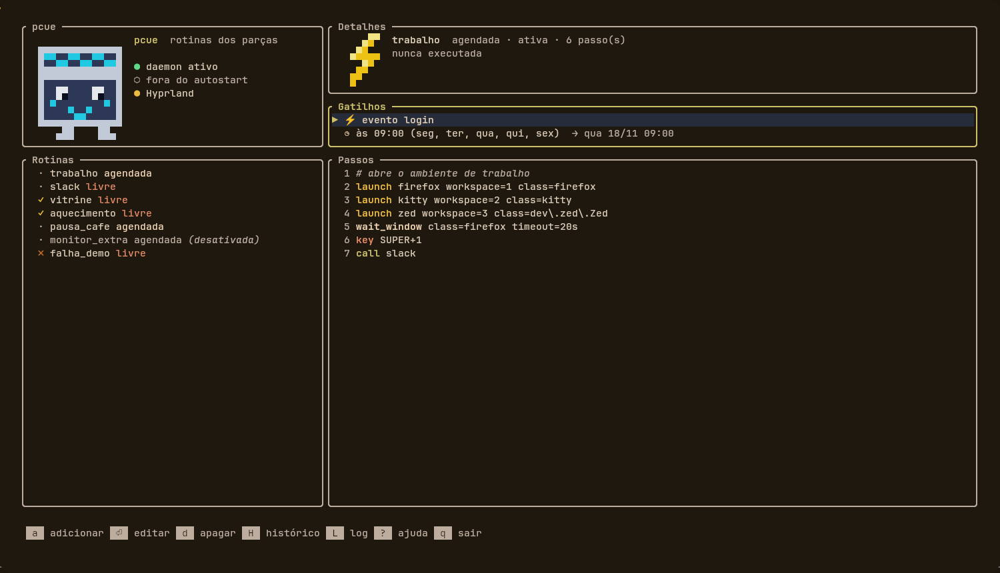

<div align="center">


# pcue

**Rotinas dos parças para o desktop, no Linux (Hyprland) e no Windows.**
Abre seus apps nos workspaces certos, grava o que você faz com teclado e mouse
e repete tudo no login, no desbloqueio, num horário ou quando você mandar.




</div>

---

## O que é

O pcue (de *cue*, a deixa do teatro) organiza **rotinas**: sequências de passos
como abrir um app num workspace, esperar a janela aparecer, apertar um atalho,
digitar um texto ou clicar num ponto de uma janela.

- **Rotinas livres** rodam quando você chama: `Enter` na TUI, duplo clique,
  `pcue run nome` ou um atalho do Hyprland.
- **Rotinas agendadas** rodam sozinhas pelo daemon: login, bloqueio,
  desbloqueio, volta da suspensão, monitor conectado/desconectado, eventos
  próprios, horário diário ou intervalo.

Tudo é gerenciado numa TUI animada, com mouse, mascote em pixel art e
acompanhamento ao vivo das execuções.

## Prints

<table>
<tr>
<td width="50%"><br/><sub><b>Execução ao vivo</b>: spinner, barra de progresso e passo atual destacado.</sub></td>
<td width="50%"><br/><sub><b>Histórico</b>: quando, gatilho, duração, passo que falhou e erro.</sub></td>
</tr>
<tr>
<td colspan="2"><br/><sub><b>Gravação</b>: contagem, REC pulsando e os passos aparecendo enquanto você age.</sub></td>
</tr>
</table>

## Recursos

| | |
|---|---|
| 🚀 **Abrir apps no workspace certo** | `launch` abre (ou reaproveita) o app, espera a janela e move para o workspace se precisar |
| ⏺️ **Gravação inteligente** | percebe app abrindo, foco e troca de workspace: grava `launch`, `focus` e `workspace` em vez das teclas, e você revisa cada trecho antes de salvar |
| 🖱️ **Cliques relativos** | cliques ficam relativos à janela, mesmo com várias janelas da mesma class |
| 🔒 **Senhas fora da gravação** | `SUPER+F9` pausa e retoma, `SUPER+F10` encerra |
| ⚡ **Gatilhos** | `login`, `lock`, `unlock`, `resume`, `monitor_added`, `monitor_removed`, eventos próprios via `pcue emit`, horário diário e intervalo |
| 🪟 **Linux e Windows** | mesma config e mesma TUI; no Windows `workspace=N` é o monitor N |
| 🧠 **Passos espertos** | `optional`, `repeat=N`, `if_window=`, `unless_window=` e `call outra_rotina` |
| 🐞 **Depuração** | rodar só um passo, rodar a partir de um passo, acompanhar e interromper execuções |
| 📜 **Histórico detalhado** | todas as execuções, com a linha que falhou e o erro; `Enter` leva direto ao passo |
| 🗂️ **Organização** | duplicar, exportar e importar rotinas em `.toml`, busca na lista |
| 🖱️ **Mouse** | clique seleciona, duplo clique roda/edita, roda rola, botões do rodapé são clicáveis |
| 🎨 **Animações** | seleção que desliza, janelas que crescem, pulso do daemon, brilho ao salvar, contagem até o próximo disparo |

## Instalação

### Pacotes

Cada release em [Releases](https://github.com/Parsec-Inc/pcue/releases) traz:

| Sistema | Arquivo | Instalação |
|---|---|---|
| Fedora / openSUSE | `pcue-X.Y.Z-1.x86_64.rpm` | `sudo dnf install ./pcue-*.rpm` (ou pelo COPR, quando ligado) |
| Debian / Ubuntu | `pcue_X.Y.Z_amd64.deb` | `sudo apt install ./pcue_*.deb` |
| Arch | AUR `pcue-bin` | `yay -S pcue-bin` (quando ligado) |
| Windows | `pcue-X.Y.Z-x86_64.msi` | duplo clique; instala só para o seu usuário, sem admin |
| Qualquer Linux | `pcue-X.Y.Z-linux-x86_64` | binário estático; copie para o `PATH` |

Os pacotes de Linux já instalam a regra de udev que dá ao usuário da sessão
acesso ao teclado, mouse e `/dev/uinput` (sem grupo `input` nem logout) e
carregam o módulo `uinput` no boot. Depois de instalar, rode `pcue install`
(ou aperte `I` na TUI) para registrar o daemon no autostart.

O `pcue update` funciona em qualquer forma de instalação: se o binário estiver
numa pasta do sistema, ele pede a senha (pkexec no Linux, UAC no Windows).

### Linux pelo código

Requisitos:

- Rust estável (edition 2024)
- Hyprland 0.56+ para workspaces, janelas e cliques (sem Hyprland os apps abrem, mas sem posicionamento)
- Acesso a `/dev/input` (gravar) e `/dev/uinput` (reproduzir)

```sh
git clone https://github.com/Parsec-Inc/pcue.git
cd pcue
cargo install --path .

# acesso a teclado, mouse e uinput para o usuário da sessão (a mesma regra dos pacotes)
sudo install -Dm644 packaging/linux/70-pcue.rules /etc/udev/rules.d/70-pcue.rules
sudo install -Dm644 packaging/linux/modules-load.conf /etc/modules-load.d/pcue.conf
sudo sh packaging/linux/postinst

# registra o daemon no autostart da sessão (ou aperte I na TUI)
pcue install
```

O daemon se reinicia sozinho quando o binário muda, então depois de um
`cargo install --path .` não precisa fazer nada.

### Windows pelo código

Requisitos: Windows 10 ou 11 e Rust estável. Não precisa de permissão de
administrador.

```powershell
git clone https://github.com/Parsec-Inc/pcue.git
cd pcue
cargo install --path .
pcue install   # registra o daemon na inicialização do usuário (HKCU\...\Run)
```

Diferenças no Windows:

- `workspace=N` é o **monitor N**, contado da esquerda para a direita;
  `workspace N` foca a janela mais recente desse monitor.
- `class` é o nome do executável sem `.exe` (ex.: `Code`, `firefox`); a class
  Win32 da janela também é aceita.
- `wait_layer` não existe; `wait_monitors` espera a barra de tarefas e a
  quantidade de monitores parar de mudar.
- `type` digita em Unicode, então funciona com qualquer layout de teclado.
- O Windows não deixa sobrescrever um `.exe` em uso, mas deixa renomear: o
  `pcue update` afasta o antigo (`pcue.old.exe`) e grava o novo no lugar.
- Config em `%APPDATA%\pcue`, log e histórico em `%LOCALAPPDATA%\pcue`.

## Uso

```sh
pcue                 # abre a TUI
pcue run trabalho    # roda uma rotina agora
pcue run trabalho --from 4   # a partir da linha 4
pcue run trabalho --only 4   # só a linha 4
pcue emit cafe       # dispara o evento personalizado "cafe"
pcue record trabalho # grava pelo terminal e acrescenta à rotina
pcue capture -w 2    # gera passos launch das janelas abertas no workspace 2
pcue list            # lista as rotinas
pcue paths           # mostra config, log e histórico
pcue update --check  # mostra se há versão nova no GitHub
pcue update          # baixa a última release, confere o SHA-256 e troca o binário
```

A TUI procura versão nova ao abrir e avisa na barra de status; `U` pergunta
antes de atualizar. Nada é instalado sem confirmação, e o daemon se reinicia
sozinho quando o binário muda.

### Atalhos da TUI

Nada vai para o disco até você salvar: as edições ficam pendentes (o topo
mostra "não salvo"), `S` grava e `u` volta ao que estava salvo. Sair ou rodar
com alterações pendentes pede confirmação, e o daemon só enxerga o que foi
salvo.

| Onde | Teclas |
|---|---|
| Geral | `S`/`Ctrl+S` salva · `u` descarta as alterações · `Tab`/`←`/`→` troca painel · `H` histórico · `L` log · `I` autostart · `U` atualiza · `?` ajuda · `q` sai |
| Rotinas | `Enter` roda · `s` para · `n` nova · `D` duplica · `r` renomeia · `d` apaga · `espaço` ativa/desativa · `t` livre/agendada · `/` busca · `X` exporta · `i` importa |
| Gatilhos | `a` adiciona · `Enter` edita · `d` apaga |
| Passos | `a` adiciona · `Enter` edita · `x` roda só este · `f` roda daqui · `J`/`K` move · `C` limpa todos (pede confirmação) · `R` grava · `c` captura janelas · `E` abre no `$EDITOR` |

Com o mouse: clique seleciona, duplo clique roda (rotina) ou edita (gatilho e
passo), a roda rola as listas e os botões do rodapé e das janelas respondem ao
clique.

## Passos

Cada rotina é uma lista de passos, um por linha:

```text
launch "firefox --new-window" workspace=2 class=firefox [focus] [always]
wait_window class=REGEX [nth=N] [timeout=30s]
focus class=REGEX [nth=N] [timeout=30s]
wait_layer namespace=REGEX [timeout=30s]
wait_monitors [timeout=30s]
workspace N
sleep 500ms
key SUPER+2
type "texto"
click [left|right|middle] [hold=CTRL] X,Y
click window=REGEX [nth=N] at=X,Y
drag [left|right|middle] [hold=SUPER] [window=REGEX] from=X,Y [via=X,Y@120ms;X,Y@300ms] to=X,Y [duration=300ms]
hold SUPER                      # ou mouse_left|mouse_right|mouse_middle [X,Y]
move X,Y [duration=300ms]       # ou move window=REGEX at=X,Y
release SUPER
scroll -3
call outra_rotina [parâmetro=valor]
# comentário
```

Qualquer passo aceita modificadores:

| Modificador | Efeito |
|---|---|
| `optional` | se falhar, registra o aviso e a rotina segue |
| `repeat=N` | executa o passo N vezes |
| `if_window=REGEX` | só executa se existir janela com essa class |
| `unless_window=REGEX` | só executa se **não** existir janela com essa class |

### Parâmetros

Uma rotina pode receber valores na hora de rodar. Declare os parâmetros com
`P` na TUI (`pessoa, mensagem=safeeerrr`: vírgulas separam, `=` dá um padrão)
e use `{pessoa}` em qualquer passo. Para mandar mensagem a qualquer pessoa no
Teams:

```text
focus class=teams
key CTRL+ALT+E
type {pessoa}
key RETURN
type {mensagem}
key RETURN
```

Ao rodar pela TUI, ela pergunta cada valor (lembrando o último usado). Fora
dela: `pcue run teams-msg pessoa=erick` (bom para um atalho do Hyprland) ou,
dentro de outra rotina, `call teams-msg pessoa=erick`. Parâmetros sem padrão
são obrigatórios; rotina agendada precisa de padrão em todos, porque o daemon
roda sem perguntar.

`focus` espera a janela existir e foca nela, trocando de workspace se
precisar. É mais robusto que `key SUPER+N`, que depende de onde o foco está.

### Gravação

`R` na TUI (ou `pcue record rotina`) grava teclado e mouse. Enquanto grava, o
pcue também observa o desktop e junta as ações com o que elas causaram:

| Você fez | O pcue sugere | Alternativas |
|---|---|---|
| abriu um app (launcher, atalho, clique) | `launch "cmd" workspace=N class=X focus` | teclas originais + `wait_window` |
| trocou de janela por atalho (`SUPER+N`, `Alt+Tab`) | `focus class=X` | `workspace N`, teclas originais |
| foi para um workspace vazio | `workspace N` | teclas originais |
| uma janela nova de um app já aberto apareceu | teclas originais + `wait_window class=X nth=N` | |

Ao encerrar, a tela de revisão mostra cada trecho com a forma escolhida:
`Tab`/`←`/`→` troca a forma, `p` liga ou desliga a pausa antes do trecho, `d`
apaga e `⏎` salva. Pausas longas (de quando você pensou) ficam visíveis para
desligar. `SUPER+F9` pausa a gravação (para senhas) e `SUPER+F10` encerra.

### Rotinas de boot

Ao adicionar o gatilho `login`, o pcue põe no início da rotina os passos que
esperam o desktop ficar pronto, conforme o que detecta na hora:

```text
# pcue: espera o desktop carregar (boot)
wait_layer namespace=quickshell:bar timeout=3m   # se houver barra conhecida (Quickshell, Waybar)
wait_monitors timeout=3m                          # Hyprland: monitores das workspace rules + workspaces no lugar
sleep 1500ms
```

O comentário marca o prefixo, então ele não é repetido. Pode editar ou apagar
os passos à vontade. No Windows o prefixo é só `wait_monitors` e o `sleep`.

`drag` segura as teclas de `hold=` e o botão em `from`, arrasta até `to` e
solta tudo. É o caso comum de `SUPER` + botão direito para redimensionar uma
janela: `drag right hold=SUPER from=800,400 to=800,700`. Para outras
combinações, `hold` aperta uma tecla ou botão e mantém até o `release`; o que
ficar apertado é solto no fim da rotina, mesmo se ela falhar. `via=` lista
pontos intermediários e quando passar por cada um, contando do início do
arrasto; o cursor anda entre eles no tempo gravado. Na gravação, arrastar com
o mouse vira `drag` com o trajeto inteiro (idas e vindas incluídas), e um
clique com modificador segurado vira `click hold=CTRL ...`. A posição de cada
clique é a do instante em que o botão desceu, mesmo em sequências rápidas.

`click window=... nth=2` mira a segunda janela da class na ordem em que foram
abertas, então dá para gravar cliques em duas instâncias do mesmo app.

## Configuração

Tudo fica em `~/.config/pcue/config.toml` (modo `0600`; no Windows em
`%APPDATA%\pcue\config.toml`). A TUI edita esse
arquivo e o daemon recarrega sozinho quando ele muda.

```toml
[settings]
timeout_secs = 30
startup_delay_ms = 1500

[[routine]]
name = "trabalho"
triggers = [
    { type = "event", event = "login" },
    { type = "daily", at = "09:00", days = ["mon", "tue", "wed", "thu", "fri"] },
]
steps = [
    "launch firefox workspace=1 class=firefox",
    "launch kitty workspace=2 class=kitty",
    "wait_window class=firefox timeout=20s",
    "key SUPER+1",
    "call slack",
]

[[routine]]
name = "slack"
steps = ["launch slack workspace=4 class=Slack unless_window=Slack"]

[[routine]]
name = "pausa_cafe"
triggers = [{ type = "interval", every = "2h" }]
steps = ["type \"bora um café?\""]
```

Arquivos:

| Caminho | Conteúdo |
|---|---|
| `~/.config/pcue/config.toml` | rotinas e ajustes |
| `~/.local/state/pcue/pcue.log` | log das execuções (texto digitado não é registrado) |
| `~/.local/state/pcue/history.jsonl` | histórico |
| `$XDG_RUNTIME_DIR/pcue/` | socket do daemon, progresso ao vivo e próximos disparos |

## Como funciona

```text
            ┌──────────────┐  eventos (logind/Hyprland ou sessão do Windows, emit)
 login ───► │ pcue daemon  │◄────────────────────────────────────────────
            │  agenda e    │  horários e intervalos
            │  dispara     │──► pcue run <rotina>  ──► player
            └──────────────┘                            │
                   ▲                                     ├─ Hyprland IPC: exec, mover, focar, cursor
                   │ next.json / progresso               └─ uinput: teclas, texto, cliques, scroll
            ┌──────┴───────┐
            │   pcue TUI   │  edita config, roda, grava (evdev), mostra histórico
            └──────────────┘
```

- **Plataforma**: `src/platform/` tem uma implementação para Linux (Hyprland,
  uinput, evdev, logind) e outra para Windows (Win32, SendInput, hooks de
  teclado e mouse, eventos de sessão); o resto do código é igual nos dois.
- **Hyprland**: o pcue fala direto com o socket IPC e detecta se o Hyprland usa a configuração em Lua (0.56+) ou a sintaxe antiga.
- **Gravação**: lê `/dev/input` com evdev (no Windows, hooks globais), agrupa texto, rolagens e atalhos, observa janelas e foco e propõe `launch`/`focus`/`workspace`.
- **Reprodução**: teclado/mouse virtual com uinput (no Windows, `SendInput`).
- **Execuções**: cada rotina roda num processo próprio, com trava por rotina, histórico e notificação em caso de falha.

## Pixel art

O mascote e os ícones foram desenhados no [Aseprite](https://www.aseprite.org/)
e ficam em `assets/sprites/`:

<p>


</p>

- `*.aseprite`: fontes editáveis, com a duração de cada quadro
- `*.png` + `*.json`: faixa horizontal exportada, embutida no binário
- `src/*.lua`: scripts que geram os sprites (`assets/sprites/src/build.sh`)

Depois de editar um sprite no Aseprite:

```sh
assets/export.sh
cargo install --path .
```

Na TUI cada célula do terminal mostra dois pixels (meio-bloco), então os
sprites têm altura par.

## Desenvolvimento

```sh
cargo test
cargo clippy
cargo run            # TUI
cargo run -- run nome --only 3
scripts/package.sh binaries deb rpm   # binários, .deb e .rpm em dist/ (ver docs/PACKAGING.md)

# Windows a partir do Linux (precisa do mingw-w64; testes rodam no wine)
cargo check --target x86_64-pc-windows-gnu
CARGO_TARGET_X86_64_PC_WINDOWS_GNU_RUNNER=wine cargo test --target x86_64-pc-windows-gnu
```
